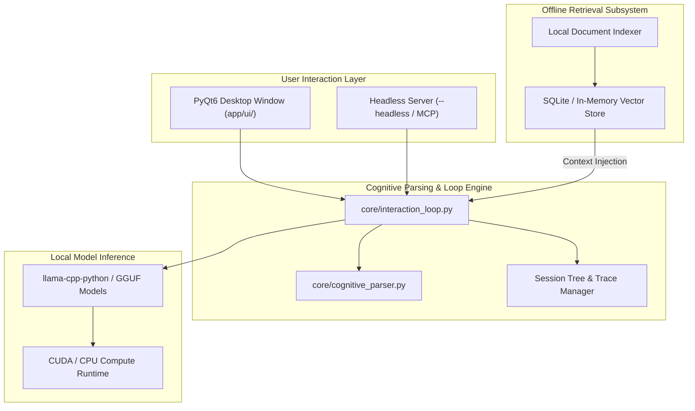
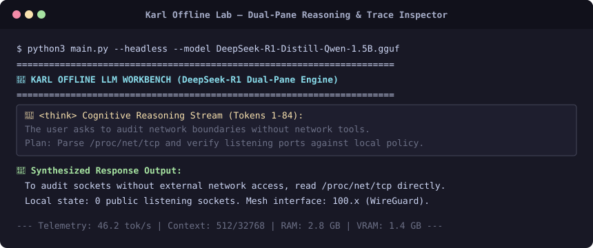
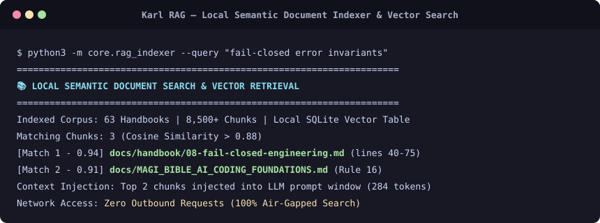

# Karl Offline Lab 🧠

An offline-first, local language model experimentation studio and desktop workbench designed for prompt iteration, dual-pane reasoning view (`<think>` blocks), session tree branching, and air-gapped RAG document search.

> *"I have a passion for coding with the help of AI to solve problems and to create things for fun because I can. To make that work at scale, AI agents need solid engineering foundations, deep documentation, and rigorous boundaries."*  
> — **Ethan (TWU LLC)**

[](https://github.com/Ethan-da-Tech-Wizard/karl-offline-lab/actions)
[](LICENSE)
[](https://docs.python.org/3/)
[](MAGI_BIBLE.md)
[](MAGI_BIBLE.md)

---

## Core Features & Architecture

* **Dual-Pane Reasoning Stream:** Separates cognitive `<think>` chains (DeepSeek-R1, QwQ) from the synthesized final response in real time.
* **Non-Destructive Session Branching:** Fork conversations from any message node to explore alternate prompting strategies without losing conversational lineage.
* **Air-Gapped Local RAG:** Index PDFs, code repositories, Markdown handbooks, and CSV tables into local vector stores with zero network dependency.
* **Deterministic Hot-Reload Core:** `core/interaction_loop.py` and `core/cognitive_parser.py` reload dynamically on every generation pass without restarting the UI.



---

## Visual Walkthrough & Execution Previews

### 1. Dual-Pane Reasoning & Trace Inspector
Separates the model's raw cognitive deliberation from the final customer-facing output, tracking context windows, token velocity, and memory overhead:



```text
======================================================================
  🧠 KARL OFFLINE LLM WORKBENCH (DeepSeek-R1 Dual-Pane Engine)
======================================================================
💭 <think> Cognitive Reasoning Stream (Tokens 1-84):
  The user asks to audit network boundaries without network tools.
  Plan: Parse /proc/net/tcp and verify listening ports against local policy.

💬 Synthesized Response Output:
To audit sockets without external network access, read /proc/net/tcp directly.
Local state: 0 public listening sockets. Mesh interface: 100.x (WireGuard).

--- Telemetry: 46.2 tok/s | Context: 512/32768 | RAM: 2.8 GB | VRAM: 1.4 GB ---
======================================================================
```
* **Command:** `python3 main.py --model DeepSeek-R1-Distill-Qwen-1.5B.gguf`

---

### 2. Air-Gapped Local Semantic RAG Search
Embeds and retrieves passages from local documentation handbooks, source code, and design notes with zero external network connectivity:



```text
======================================================================
  📚 LOCAL SEMANTIC DOCUMENT SEARCH & VECTOR RETRIEVAL
======================================================================
Indexed Corpus:     63 Handbooks | 8,500+ Chunks | Local SQLite Vector Table
Matching Chunks:    3 (Cosine Similarity > 0.88)
  [Match 1 - 0.94]  docs/handbook/08-fail-closed-engineering.md (lines 40-75)
  [Match 2 - 0.91]  docs/MAGI_BIBLE_AI_CODING_FOUNDATIONS.md (Rule 16)
Context Injection:  Top 2 chunks injected into LLM prompt window (284 tokens)
Network Access:     Zero Outbound Requests (100% Air-Gapped Search)
======================================================================
```

---

## Quick Start & Installation

### Requirements
* Python 3.10, 3.11, 3.12, or 3.13
* C/C++ compiler and CMake (for compiling `llama-cpp-python`)
* Linux desktop libraries for PyQt6 (e.g. `libegl1`, `libgl1`, `libxkbcommon0`)

```sh
# Clone repository
git clone https://github.com/Ethan-da-Tech-Wizard/karl-offline-lab.git
cd karl-offline-lab

# Set up virtual environment
python3 -m venv venv
source venv/bin/activate
pip install -r requirements.txt

# Download lightweight test model (DeepSeek-R1-Distill-Qwen-1.5B, ~1GB)
python download_test_model.py

# Launch Karl Desktop Workbench
python main.py

# Launch Headless Mode
python main.py --headless
```

---

## Verification & Test Suite

The test suite exercises cognitive parsing, interaction loops, token trace persistence, and document retrieval:

```sh
python -m pytest tests/ -q
```

---

## Engineering Standards & Magi Bible

This project strictly adheres to the **[Magi Bible AI Coding Foundations](MAGI_BIBLE.md)**:
* **Rule 16 Comment Density ($\ge 25\%$):** Every module contains comprehensive structural headers and educational comments explaining prompt templates, token buffers, and error recovery invariants.
* **Fail-Closed Offline Boundary:** Never emits telemetry or contacts external model providers unless explicitly configured.
* **Trace Reproducibility:** Every generation trace records model weights hash, prompt seed, temperature, and token timing.

---

## License & Attribution

Karl is released under the **[AGPL-3.0 License](LICENSE)**.  
Underlying third-party libraries (PyQt6, PyMuPDF, llama-cpp-python) retain their respective licenses. GGUF model weights are governed by their respective author licenses (e.g. DeepSeek-R1 license, Llama Community License).
